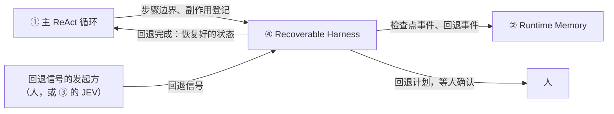
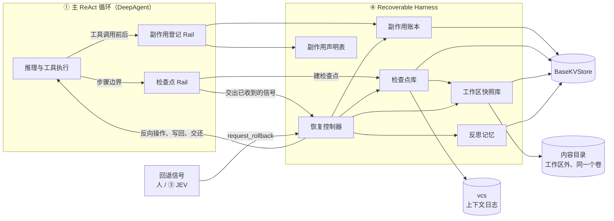
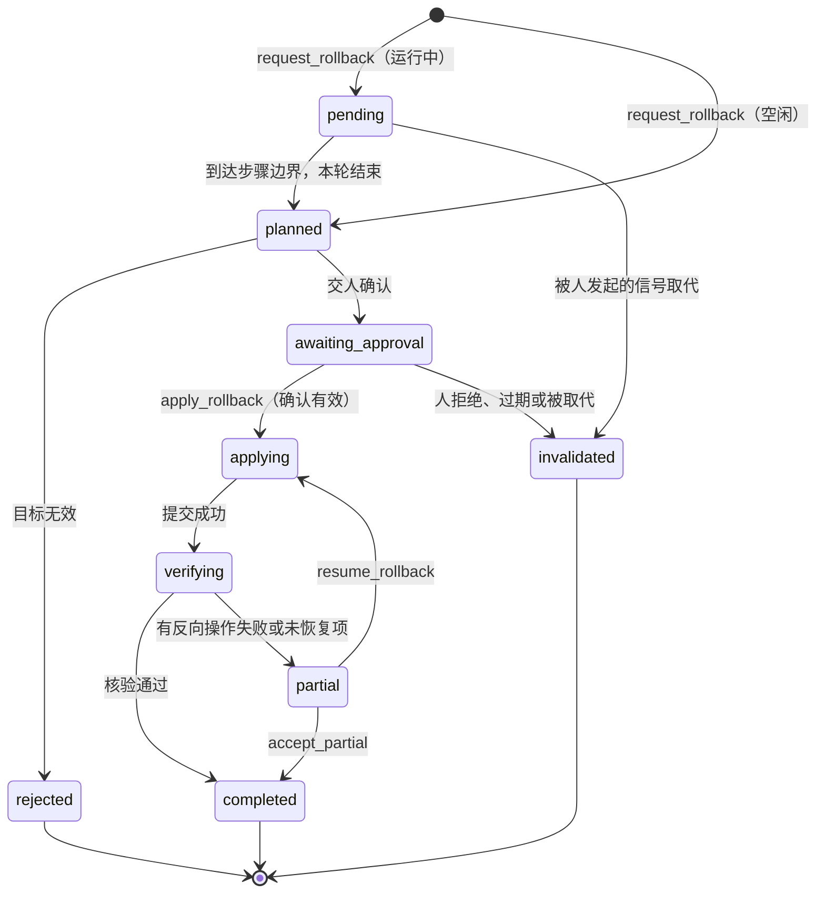
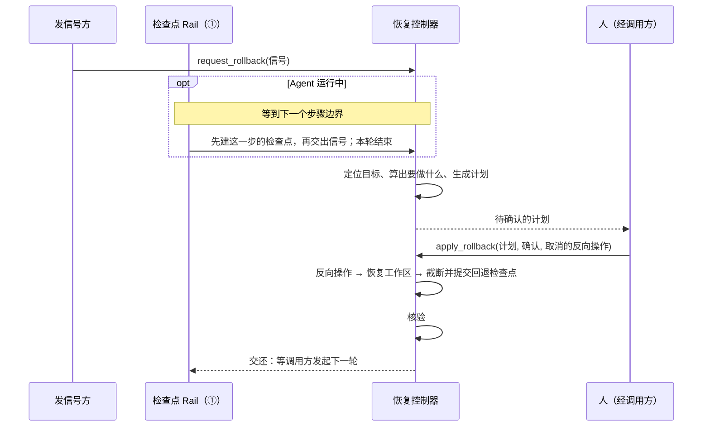

# Recoverable Harness 步级回退设计方案

## 1. 设计定位与阅读说明

本文是 Recoverable Harness（下文简称 ④）的开发前方案，尚无实现。第 4.2 节的关键决策都已经和需求方逐条确认，
确认日期见第 10 节；标 **（建议）** 的是提出了、还没确认的做法；第 3 节列出尚未验证的前提（V）和待定问题（P）。

**阅读顺序：** 第 2 节讲它做什么，用一个贯穿全文的例子说明回退前后的样子；第 4 节是总体方案和关键决策，
读完就能理解整体；第 5 节是详细设计，其中第 5.11 节讲检查点怎样建立、工作区怎样恢复、副作用怎样登记；
第 6～9 节是实施项、验证和限制。

## 2. 背景、目标与范围

### 2.1 背景与问题

Agent 在执行中常常走错路：改错了文件、建错了外部资源、装了不需要的依赖。现在只能靠人手工收拾。
DeepSeek Harness 等已有的回退只回退对话上下文，不处理文件和外部效果。

④ 是"ReAct Agent 运行时干预架构"的第④层，给 Agent 提供类似 git 的回退能力：

- Agent 每走一步，④ 自动建立一个检查点。
- 人或 ③ 的 JEV 发来回退信号，指定回到哪个检查点。④ 算出回退计划，经人确认后执行。
- ④ 把上下文、运行状态和整个工作区恢复到那个检查点，不管工作区的改动是 Agent 做的还是用户做的；
  Agent 对工作区以外做过的事，能撤的撤，撤不了的如实告诉 Agent。
- 回退不能撤销。回到某个检查点后，它之后的检查点永久删除。

④ 是独立模块。第一版服务 DeepAgent，以后可以扩展到 Persistent Agent（下文简称 PA）。



箭头表示调用或通知的方向。① 在每个步骤边界通知 ④，并在工具调用前后登记副作用。④ 不判断该不该回退，
也不决定回到哪里；它算出计划交人确认，确认后执行，再把恢复好的状态交还 ①。

### 2.2 目标与关键场景

下面这个例子贯穿全文。Agent 接到任务"整理周报并提交工单"，走了五步：

| 步 | Agent 做了什么 | 对外部的影响 | 这一步结束时的检查点 |
| --- | --- | --- | --- |
| — | 本轮开始 | — | C0 |
| S1 | 读 `config.yaml` | 无 | C1 |
| S2 | 编辑 `report.md` | 改了工作区文件 | C2 |
| S3 | `create_ticket` 创建工单 T-1；同时用户在 IDE 中修改了 `notes.md` | 外部系统多了一张工单，可以关闭；工作区文件被用户改了 | C3 |
| S4 | `send_message` 给用户发进度消息 M | 消息已发出，撤不回 | C4 |
| S5 | shell 执行 `pip install pandas`，装进工作区的 `.venv`；再新建 `summary.md` | 依赖环境多了 pandas 和它依赖的几个包；工作区多了一个文件 | C5 |

用户发现从 S2 起方向就错了，发出"回到 C1"的信号。④ 列出回退计划，用户确认后执行：

| 对象 | 当前行为 | 目标行为 |
| --- | --- | --- |
| 上下文 | 不支持回退 | 回到 C1：S2～S5 的消息全部去掉，末尾追加一段回退说明 |
| `report.md` | 不支持 | 写回 C1 时的内容 |
| `notes.md` | 不支持 | 写回 C1 时的内容。回退不区分是谁改的，用户自己的修改也一起撤掉 |
| `summary.md` | 不支持 | 删除，因为 C1 时还没有这个文件 |
| `.venv` | 不支持 | 恢复成 C1 时的包列表：卸载 pandas 和顺带装上的包 |
| 工单 T-1 | 不支持 | 调用 `close_ticket` 关闭 |
| 消息 M | 不支持 | 撤不回，在回退说明里告诉 Agent |
| C2～C5 | — | 永久删除，不能再回到这些检查点；账本里这几步的记录保留，标为已放弃 |

之后 Agent 从 C1 接着执行。它能看到回退说明，知道刚才那条路为什么被放弃。完整的验收条件见第 8 节。

### 2.3 本次范围与非目标

| ④ 负责 | 不负责（由谁负责） |
| --- | --- |
| 在每个步骤边界自动建立检查点 | 判断要不要回退、回到哪个检查点（人，或 ③ 的 JEV） |
| 登记 Agent 对工作区以外的影响 | 风险评估、收益判定（②③） |
| 接收回退信号，算出计划，经人确认后执行 | 向人展示计划、收集确认（调用方，例如 CLI、IDE 或服务层） |
| 恢复上下文、文件和依赖，执行反向操作，核验结果 | 回退后 Agent 怎样继续，需要推理的修复（①） |
| 告诉 Agent 放弃了什么 | 拦截重复动作（① 的动作预检，④ 只提供数据）；告诉 Agent 用户改了什么（另行设计，可能归 ②） |
| 保证同一工作区同一时间只有一个会话开启回退 | 子 Agent 内部（本期不做，见第 4.1 节）；预算（被放弃路线花掉的成本不返还） |

### 2.4 术语与上下文

- **一步**：ReAct 循环的一次迭代（[react_agent.py](../../../../../openjiuwen/core/single_agent/agents/react_agent.py)
  中 `invoke` 的迭代循环）。模型调用一次，执行这次回复中的全部工具调用，再把全部结果写回上下文。
  同一步中的工具调用可能并行执行（[ability_manager.py](../../../../../openjiuwen/core/single_agent/ability_manager.py)
  `_execute_parallel_tool_tasks`）：`write_file`、`edit_file` 单独执行，同一文件上的调用按模型给出的顺序执行，其他调用默认同时执行。
  结果都在全部执行完后统一写回，调用之间没有可以回去的中间状态。
- **一轮**：一次 invoke，从用户输入到最终回答，包含若干步。
- **步骤边界**：一步刚结束、下一步还没开始的时刻。没有模型调用或工具正在执行，所有工具调用都已有结果。
- **检查点**：④ 在步骤边界记下的一个可回退位置。它本身不存内容，只记下这一刻三份记录各自写到了哪里：

  | 记录 | 记什么 | 由谁维护 |
  | --- | --- | --- |
  | 上下文日志 | 消息与运行状态 | vcs（第 5.11.1 节） |
  | 工作区记录 | 每个文件当时的内容；依赖目录当时的包列表 | 工作区快照库（第 5.11.2 节） |
  | 副作用账本 | Agent 每次可能影响工作区以外的工具调用 | 副作用账本（第 5.11.3 节） |

- **HEAD**：当前所在的位置，即最新的检查点。历史只有一条线，每个检查点记一个父检查点。
- **回退检查点**：回退完成时在目标之后新建的检查点，里面放回退说明，Agent 从这里接着执行。
- **反向操作**：撤销一次外部效果的操作，例如 `close_ticket(T-1)`、`docker rm -f db`、卸载一个包。
- **工作区**：Agent 的工作目录，通常就是用户的项目目录。

## 3. 设计约束、假设与待决问题

**已确认约束与依赖：**

- **只在步骤边界动手。** 正在进行的模型调用和工具不能打断，因为工具的副作用可能已经发生。
  运行中收到的回退信号要等到下一个步骤边界才处理。同一个 Session 同一时间只有一个写者。
- **工作区以外的影响要登记或声明才能处理。** ④ 只知道登记过的调用、Agent 声明过的效果和 ④ 自己检查到的包安装，
  其余的无从得知，只能如实说明"以 Agent 的声明为准"。
- **外部系统不受我们控制。** 反向操作是尽力而为，本身也可能失败。
- **每一步都建检查点，成本要低。** 上下文只记新增的部分，文件只处理变了的，依赖目录和构建产物不进快照。
- **Agent 和用户可以同时编辑工作区。** Agent 的改动直接出现在用户目录里，用户的改动 Agent 也能看到，
  所以不能像覆盖层那样把 Agent 隔离在另一层（R-05）。
- **回退不能撤销，所以执行前都要人确认。**
- 需要修改 `core/` 的地方单列在第 6.1 节，都是增量修改，由对应模块维护者评审。

**关键假设（尚未验证）：**

| # | 前提 | 不成立时的影响 | 核实方式 |
| --- | --- | --- | --- |
| V1 | vcs `restore(at)` 能正确还原任一提交，包括被卸载的消息；`rewind(at)` 在 JSONL 和 BaseKVStore 后端上都能正确截断 | 回退依赖它 | vcs 组件测试 |
| V2 | 写回上下文和状态后，DeepAgent 能从这个状态继续执行；`load_state` 覆盖任务计划、模式等运行状态；DeepAgent 平时在什么时候调用 `save_state` | 运行状态不及时写进 Session，检查点就记不到 | 读代码并写集成测试 |
| V3 | vcs 在长历史上的还原性能可以接受 | 回退的响应时间 | 基准测试 |
| V4 | 每一步建检查点的开销在常见规模下可以接受。当前仓库实测扫描 6,620 个文件约 50 毫秒；还要在大仓库、系统缓存为空时测 | 每一步的额外耗时；决定要不要改用文件变更通知 | 基准测试 |
| V5 | 运行中在步骤边界结束本轮后，回退能让下一轮从目标状态正确开始；停在确认中断时回退，中断状态随目标一起还原 | 运行中回退依赖它 | DeepAgent 集成测试 |
| V6 | 按文件属性比对能可靠发现变化。已知会漏检：写入后保留原修改时间且大小不变，例如 `cp -p` | 工作区恢复的完整性 | 构造漏检场景 |
| V7 | 在 APFS、btrfs、XFS 上，用文件克隆保存 C0 和改动足够快 | C0 的耗时和存储 | 基准测试 |
| V8 | 快速检查能发现各包管理器的安装：npm、pnpm、yarn、pip、uv、conda 各自会改哪个文件；yarn 的 PnP 模式没有 `node_modules` | 依赖恢复的完整性 | 逐个包管理器实测 |
| V9 | 按包列表装回目标版本在常见情况下可行，包括从本地路径、git 地址安装的包 | 依赖恢复能否做到 | 实测 |

**待决问题：** 编号沿用讨论中的编号，已解决的不再列出。

| # | 问题 | 当前建议 | 谁确认 | 是否影响第一版实现 |
| --- | --- | --- | --- | --- |
| P2 | 副作用类别声明长期放在哪里 | 第一版用 ④ 的声明表（第 5.11.3 节）；长期放在 ToolCard 的新字段 | core 与 harness 维护者 | 否 |
| P3 | 沙箱中工作区以外的状态怎样恢复 | 第一版按不可逆处理。以后接入覆盖层后端，已安装的软件等文件层面的状态也能回退，进程仍然不能 | 沙箱维护者 | 否 |
| P5 | sys_operation 没有删除方法，而恢复时要删除目标之后新建的文件和构建产物 | 给 sys_operation 增加删除方法（增量）；本地模式可以先直接删除 | sys_operation 维护者 | 沙箱模式受影响 |
| P6 | 回退说明要不要加模型生成的总结 | 第一版不加；需要时借鉴 DeepSeek Harness 的限长总结 | 待定 | 否 |
| P7 | 账本怎样得知一次工具调用经用户批准 | 确认类中断 Rail 在用户批准时写一个标记，账本 Rail 读取；只改 harness。只用于确认时的提示，不影响授权 | rails 与 security 维护者 | 否 |
| P8 | 超过自动回退次数上限后怎样处理，默认上限多少 | 上限只用来避免反复打扰人：超过后不再交人，直接拒绝并发出事件；上限可配置，例如同一目标 2 次、同一轮 5 次 | 待定 | 是 |
| P9 | 模型没调工具但循环继续时（有待注入的插话等），这一步没有结束回调 | 在下一次 `BEFORE_MODEL_CALL` 时补建；此时插话已注入，回到这个检查点会保留插话。备选：并入下一步 | 开发者 | 是 |
| P10 | 怎样复用 PA 的持久化模块 | 检查点只记各日志的位置；上下文日志和副作用日志各定义一个接口，DeepAgent 用 vcs 和 ④ 的账本实现，PA 用它的窗口与归档、执行日志实现。复用 PA 的存储做法（不可变记录写入时比对内容）、写前意图 Rail（把写入目标抽成接口）、消息编解码与补齐缺失工具结果的函数。PA 的会话存储不能直接当 DeepAgent 的上下文日志：记录结构是 PA 专用的，存的是最新状态加换窗归档，不是逐步日志 | 开发者与 PA 维护者 | 是 |
| P11 | 回退说明中的证据引用可能已过期：旧路线改过文件后又读取，读到的内容与回退后的文件不一致 | 每条引用记下读取时所在的检查点；读取发生在旧路线某次写操作之后的，标为"可能过期" | 开发者 | 否 |
| P13 | 工作区以外的其他本地状态（本地数据库、启动的服务等）第一版承诺做到哪一步；只回退文件可能造成不一致 | 第一版按不可逆如实报告；可能不一致时是提醒还是拒绝回退，待讨论 | 开发者 | 否 |
| P14 | 回退时还有外部进程在用工作区（开发服务器、IDE 的 git 集成），以及后台子 Agent | Agent 启动的后台进程按 PID 停掉（已定）；外部进程只能提醒；后台子 Agent 待讨论 | 开发者 | 否 |
| P19 | 进程重启后怎样恢复：默认的内存 checkpointer 重启即丢，④ 的数据还在 | 要求宿主配置持久的 checkpointer，或由 ④ 从 vcs 恢复 Session | 开发者 | 是 |
| P20 | 工作区快照和工作区外文件的备份中的敏感内容（`.env`、密钥） | 访问控制，过期后真正删除；是否加密待定 | 开发者与安全维护者 | 否 |
| P22 | 依赖目录、构建产物、对外命令三份名单的默认内容 | 第 5.11 节列出的是起点，开发时逐个核对，并允许宿主配置 | 开发者 | 是 |
| P23 | shell 与执行代码工具的声明参数：参数形态、提示词写法 | 只在开启 ④ 时加这个参数 | 工具负责人 | 是 |

## 4. 总体方案与设计取舍

### 4.1 方案概览

回退分三条线处理：

**上下文与运行状态：整体回到目标检查点。** 目标之后的内容全部从上下文中去掉，包括模型回复、只读调用及其结果、写调用。
运行状态指 DeepAgent 的任务计划、迭代号、计划模式等，以及 Session 中的其他状态，同样回到目标时刻。

**工作区：整体回到目标检查点时的状态。** 不区分改动是谁做的：Agent 的工具、shell、脚本改的，
和用户在 IDE 中改的，一样撤掉。被撤掉的改动不保留。

| 工作区里的东西 | 怎样恢复 |
| --- | --- |
| 普通文件，包括 `.git` | 按检查点的清单写回或删除 |
| 依赖目录（`node_modules`、`.venv` 等） | 不进快照。每个检查点记一份包列表，回退时把环境恢复成这份列表：多出来的卸载，少了的、版本变了的装回 |
| 构建产物（`dist/`、`target/` 等） | 不进快照。回退时删除，之后重新构建 |

**工作区以外：只撤 Agent 做过的。** 工作区以外的东西全机共用，④ 也没有记下它们在检查点时的完整状态，
所以只处理账本里 Agent 做过的事，用户自己做的不动。每次调用按副作用类别处理：

| 类别 | 例子 | 回退时 |
| --- | --- | --- |
| 无外部效果 | `read_file`、`write_file`、`pytest`、`npm install` | 无需处理。工作区里的改动由快照恢复，装进工作区的包按包列表恢复 |
| 可反向 | `create_ticket`（撤销：`close_ticket`）、`docker run --name db`（撤销：`docker rm -f db`）、改 `~/.zshrc` | 执行反向操作 |
| 不可逆 | 已发出的消息、`git push`、改远程数据库 | 无法撤销，告诉 Agent |
| 保留 | 记忆写入、知识写入 | 有意不回退，告诉 Agent 它来自被放弃的路线 |

反向操作有三个来源：效果固定的工具查声明表；shell 和执行代码的工具由模型逐条声明；
全局安装、工作区外文件和后台进程由 ④ 自己生成（第 5.11.3 节）。没有声明类别的按不可逆处理。
只登记了意图、没有结果的调用（例如工具执行中进程崩溃）状态为"未知"：工具能查询的就先查询再决定，查不到就告诉 Agent，不撤销。
不论哪一类，回退后每个副作用都要有明确去向：已恢复、已撤销、不可逆或状态未知，不能悄悄丢掉。

**回退后删掉什么、留下什么。** 例子中在 C5 回到 C1：

```text
回退前：      C0 → C1 → C2 → C3 → C4 → C5      HEAD 在 C5
回退后：      C0 → C1 → R1                     HEAD 在 R1
继续执行后：  C0 → C1 → R1 → C6 → C7
```

- C2～C5 永久删除：vcs 截断 C1 之后的记录，这几个检查点的清单、包列表和只被它们用到的文件内容一并清理。
  外部拿着它们的 ID 发来的请求一律拒绝。
- 不跟着删的有三样：
  - 账本里 S2～S5 的记录标为"已放弃"后保留，因为这些事在外部真实发生过，没撤成的项还要作为待办；
  - 回退说明放在 R1 里；
  - 回退次数由 ④ 单独保存，否则每回退一次计数就清零，次数上限（P8）就失效了。

**子 Agent 与 computer use（本期不单独处理）：**

- 前台运行的子 Agent，在父 Agent 看来是一步中的一个工具调用，只能整个撤掉。它改的工作区文件随父 Agent 一起恢复；
  它调用的有副作用的工具不在父 Agent 的账本里，回退说明只能提示"子 Agent 的外部效果未处理"；它自己的会话和记忆不回退。
- 后台子 Agent 怎样处理待定（P14）。
- computer use（cua、mobile_gui）和浏览器改到工作区的文件能恢复；在屏幕、应用、网站上产生的效果按不可逆处理。

**组成：**



④ 不进入 ReAct 循环内部，只通过 ① 挂载的两个 Rail 与它协作：检查点 Rail 在步骤边界建立检查点，
并把此前收到的回退信号交给恢复控制器；副作用登记 Rail 在工具调用前后登记副作用。回退信号从 ④ 自己的入口进来，不经过 ①。
各部分的职责见第 5.1 节。

### 4.2 关键决策

以下决策都已经和需求方确认，确认日期见第 10 节。

#### D-01 回退单位是步，检查点在每个步骤边界自动建立，只记日志位置

- 选择与依据：一步中的工具调用并行执行、结果统一写回，调用之间没有可回去的中间状态。检查点由 ④ 的检查点 Rail 自动建立，
  外部只引用检查点 ID。检查点只记上下文日志、工作区记录和副作用账本各自写到了哪里。
- 代价与成立条件：无法只撤销一步中的某个调用；运行中的信号最多晚一步生效。
- 实现体现：第 5.7.1 节、第 5.11.1 节。
- 相关候选：R-01。

#### D-02 回退不能撤销，目标之后的历史删除

- 选择与依据：用 vcs `rewind` 截断目标之后的日志、快照和提交，没有分支，也不保留被撤掉的改动。
  存储有上限，实现简单；被撤销的外部效果本来也回不去。
- 代价与成立条件：回退错了找不回来，所以每次回退都要人确认（D-03）。
- 实现体现：第 4.1 节"回退后删掉什么、留下什么"、第 5.11.4 节。
- 相关候选：R-02、R-03。

#### D-03 每次回退都先交人确认

- 选择与依据：不论人发起还是 JEV 发起，都先把计划交给人确认，确认后才执行。运行中收到信号时，
  在下一个步骤边界结束本轮，确认后在空闲时执行。等待确认期间目标不变，执行时按当时的状态重新计算，
  发起之后的改动也会被撤掉。反向操作只能在确认时逐条取消，确认之后才开始执行。
- 代价与成立条件：多一次确认；运行中回退要先结束本轮；Agent 在等待期间不能往下做。
- 实现体现：第 5.7.2 节、第 5.11.5 节。
- 相关候选：R-04。

#### D-04 工作区整体回到检查点，不区分谁改的

- 选择与依据：只撤 Agent 的改动，就要判断每个改动是谁做的，而 shell 运行期间分不清；两人改了同一个文件时还要合并。
- 代价与成立条件：用户的修改也会被撤掉，而且找不回来；为此同一工作区同一时间只允许一个会话开启回退，
  确认时提示会消失的 git 提交数，并提醒 IDE 中没保存的修改。
- 实现体现：第 5.11.2 节。

#### D-05 依赖目录和构建产物不进快照

- 选择与依据：依赖目录通常占工作区的大头，一次安装就改动上万个文件；构建产物开销同样大，而且能重新生成。
  依赖按每个检查点记下的包列表恢复，不管是谁装的；构建产物回退时删除，之后重建。`.git` 仍在快照里，保证代码和 git 状态一致。
- 代价与成立条件：装回依赖需要联网；用户自己装的包也会被卸掉；回退后要重新构建，增量构建的缓存也没了。
- 实现体现：第 5.11.2 节。
- 相关候选：R-06、R-07。

#### D-06 每一步扫描一次找改动

- 选择与依据：大部分写入方（shell、脚本、用户）不上报路径，只能在建检查点时去发现。依赖目录和构建产物不进快照后，
  常见项目扫描一次只要几十到几百毫秒。接口按"上次检查点之后变了哪些路径"设计，以后换成文件变更通知不影响其他部分。
- 代价与成立条件：扫描耗时和文件数成正比；在大仓库上实测后再决定要不要改用通知（V4）。
- 实现体现：第 5.11.2 节。
- 相关候选：R-08。

#### D-07 工作区以外只撤 Agent 做过的

- 选择与依据：工作区以外的东西全机共用，④ 也没有记下它们在检查点时的完整状态。
- 代价与成立条件：用户在工作区外做的事不回退。
- 实现体现：第 5.11.3 节。

#### D-08 效果固定的工具查声明表，shell 和执行代码的工具由模型逐条声明

- 选择与依据：效果固定的工具写一次就够了，而且撤销往往要用到调用结果（工单号是服务器分配的）；shell 每次调用的效果都不同。
  声明表中，内置工具由 ④ 的开发者写，宿主注册的工具由其开发者写，MCP 工具默认取服务器给的提示（需要改 core 保留它们）。
  shell 的声明参数必填，没有声明的按不可逆处理；命中对外命令名单的"无外部效果"声明改按不可逆登记，但不拦命令。
- 代价与成立条件：模型的声明没法核实，只能用名单补漏。
- 实现体现：第 5.11.3 节、第 6.1 节 I-05、I-06。
- 相关候选：R-09。

#### D-09 包、工作区外文件和后台进程的反向操作由 ④ 生成

- 选择与依据：模型在执行前看不到结果，不知道原来有没有、顺带装了什么、升级了什么。全局安装由 ④ 在认出的安装命令前后各取一次包列表，
  比较后生成；工作区外的文件由 ④ 按模型声明的路径执行前备份；后台进程按 PID 停掉。
  模型写的反向命令只用于新建类的效果；覆盖、修改、删除远程服务、数据库、云资源的，第一版按不可逆处理。
- 代价与成立条件：全局安装前后各取一次包列表；声明的路径执行前要备份；模型漏写的路径不会被备份。
- 实现体现：第 5.11.3 节。

#### D-10 执行顺序为反向操作 → 恢复工作区 → 截断并提交

- 选择与依据：反向操作可能顺手改了工作区（例如 `npm uninstall` 改 `package.json`），工作区放在后面恢复，结果才严格等于目标状态；
  反向操作执行时，文件还是回退前的最新内容。反向操作失败时停在失败项，剩下的不做，但工作区照常恢复、照常提交，标为部分完成。
  执行前不另存工作区。
- 代价与成立条件：工作区恢复失败时外部已经变了，回退不能中止，只能重试。
- 实现体现：第 5.11.4 节。
- 相关候选：R-10。

#### D-11 存储位置与上限

- 选择与依据：文件内容放在工作区外、和工作区在同一个卷上的目录，按工作区共用，能克隆就克隆；小记录放宿主注入的存储。
  单个文件上限在不能克隆时默认 1 GB，能克隆时不设，`.git` 不设。总量上限默认 100 GB，同时保证磁盘至少剩 20%，
  超过时从最老的检查点删起并提示用户。检查点随会话保留。
- 代价与成立条件：超过单文件上限的文件被改或被删后无法恢复，建 C0 时列给用户。
- 实现体现：第 5.5 节、第 5.11.2 节。

#### D-12 放在 harness 层的独立模块，复用 PA 的持久化

- 选择与依据：放在新模块 `openjiuwen/harness/recoverable/`。core 不能依赖工具、Rail、工作区等 harness 概念；
  `harness_protocol` 只放契约；vcs 不该承担副作用和工作区。第一版服务 DeepAgent，可以扩展到 PA，复用 PA 的持久化，不另做一套。
- 代价与成立条件：其他 harness 需要新增绑定；复用方式待定（P10）。
- 实现体现：第 6.1 节。

### 4.3 替代方案与排除理由

| 候选 / 关联决策 | 候选目的与关键差异 | 拒绝或暂缓原因 | 重新评估条件 |
| --- | --- | --- | --- |
| R-01 / D-01 按单个工具调用回退 | 更细的回退粒度 | 一步中的调用并行执行、结果统一写回，没有中间状态；只回退部分调用要伪造模型回复 | — |
| R-02 / D-02 保留旧路线为分支，可以切回 | 回退后后悔还能切回去 | 要维护分支和救援点，存储没有上限；被撤销的外部效果切回时也回不去 | — |
| R-03 / D-02 回退后先试着恢复本地状态，给人看实际结果再确认或取消 | 让人看过真实结果再定 | 只有本地部分能试，外部部分仍要确认后才执行；流程更复杂。需求方讨论后放弃 | — |
| R-04 / D-03 人发起的回退直接执行 | 少一次确认 | 回退不能撤销，看一眼计划的代价很小 | — |
| R-05 / 第 3 节 覆盖层（AgentFS 的做法） | 不用扫描就有准确的改动列表，不用事先存 C0 | Agent 的改动不出现在用户目录里；Agent 看不到用户对它改过的文件的修改；没有按步快照；每次读写都经过 FUSE 或 NFS，不支持 Windows | 沙箱模式（P3） |
| R-06 / D-05 依赖目录放进快照 | 回退后代码和依赖严格一致 | C0 和装依赖的步骤都要存上万个文件 | — |
| R-07 / D-05 构建产物不删，只提示重建 | 省去重建 | Agent 可能直接用上旧路线的产物 | — |
| R-08 / D-06 文件变更通知 | 省掉每步扫描 | 要处理异步送达、队列溢出、重启后全量扫描；远程沙箱用不了 | 大仓库实测扫描太慢（V4） |
| R-09 / D-08 shell 一律按不可逆处理 | 不依赖模型声明 | 每次回退说明里都有"可能有撤不回的效果"，失去意义 | — |
| R-10 / D-10 文件 → 补偿 → 提交 | 文件恢复失败时能中止回退、外部不变 | 反向操作可能再改工作区，结果不等于目标状态 | — |

## 5. 详细设计

### 5.1 模块责任与关键不变量

| 部分 | 负责 | 不负责 |
| --- | --- | --- |
| 恢复控制器 | 接收信号、生成计划、交人确认、按顺序执行、核验、交还结果；记录回退进度，崩溃后接着做 | 判断该不该回退；向人收集确认 |
| 检查点库 | 建立检查点；维护父检查点和 HEAD；回退后删除目标之后的检查点 | 上下文的存储（vcs 负责） |
| 副作用登记 Rail | 工具调用前后登记；读取 shell 的声明，并按对外命令名单修正；全局安装前后取包列表；备份声明的工作区外文件；记下后台进程的 PID | 拦截命令（权限引擎负责） |
| 副作用声明表 | 效果固定的工具的类别与撤销方法 | 执行撤销 |
| 副作用账本 | 保存每次调用的类别、结果、反向操作和备份引用 | 执行工具 |
| 工作区快照库 | 发现改动（不区分谁改的）；保存清单、文件内容和包列表；按记录恢复文件和依赖；删除构建产物 | 工作区以外的状态 |
| 反思记忆 | 保存所有回退说明和被否决的动作，供查询 | 拦截重复动作（① 负责） |
| DeepAgent 绑定 | 提供两个 Rail；读写 DeepAgent 状态；借用 ① 的工具环境执行反向操作；回退后让 Agent 继续 | — |

除 DeepAgent 绑定外，各部分不依赖 DeepAgent。以后接入 PA 或其他 harness，只需新增一个绑定（P10）。

**关键不变量：**

| # | 保证 | 成立条件 | 验证 |
| --- | --- | --- | --- |
| G-01 | 回退完成后，工作区（依赖目录和构建产物除外）与目标检查点的清单一致，依赖与目标的包列表一致 | 第 5.9 节的保证条件成立；没有超过单文件上限的文件被改 | V-07、V-08 |
| G-02 | 每个登记过的副作用都有去向：已恢复、已撤销、人取消、不可逆或状态未知 | 副作用经过登记或声明 | V-16 |
| G-03 | 账本的意图记录写成功之前，有外部效果的工具不会执行 | — | V-13 |
| G-04 | 没有人确认的计划不会执行；确认之后才开始反向操作 | — | V-03 |
| G-05 | 被删除的检查点不能再作为回退目标 | — | V-06 |

### 5.2 关键类与函数设计

尚未细化到类和函数，开发阶段按第 5.1 节的部分拆分，在 features 中记录。

### 5.3 接口定义与消息契约（草案）

```text
# 查询：供发信号方选择目标
get_checkpoint(checkpoint_id) -> Checkpoint
history(limit) -> list[Checkpoint]                       # 从 HEAD 沿父检查点往回

# 回退
request_rollback(signal) -> RollbackTicket               # 接收信号；运行中等到下一个步骤边界
plan_rollback(target_checkpoint_id) -> RollbackPlan      # 只看计划，不执行；就是确认前的预览
apply_rollback(plan_id, approval) -> RollbackResult      # 确认一份待确认的计划并执行
resume_rollback(rollback_id) -> RollbackResult           # 再试剩余项，或崩溃后接着做
accept_partial(rollback_id, approval) -> RollbackResult  # 接受部分完成的结果
get_rollback(rollback_id) -> RollbackStatus
```

| 字段 / 参数 | 说明 |
| --- | --- |
| 回退信号 `signal` | `{signal_id, 目标检查点, 发起方, 来源, 理由}`。发起方只有"人"和"自动"两种；来源记录具体是谁发的，例如 JEV，只写进回退说明；`signal_id` 用来去重，同一信号重复投递返回同一次回退 |
| `approval` | 绑定计划 ID 和目标检查点，并带上人取消的反向操作；④ 只检查确认与计划是否一致 |
| 检查点事件 | 已建立 `{checkpoint_id, 轮次, 步序号}`、建立失败。② 可以把检查点 ID 记进自己的步骤记录，③ 发信号时引用它 |
| 回退事件 | 已接收、已拒绝、等待确认、已作废、已执行、部分完成。只是通知，回退的事实以回退进度记录和检查点库为准 |

- 建立检查点由检查点 Rail 在内部完成，不对外提供。
- 引用已删除检查点的调用一律返回"检查点已删除"。
- 授权规则是可替换的组件，以后可以接入权限引擎，第一版不接。

### 5.4 配置与能力控制

| 配置 | 默认值 | 说明 |
| --- | --- | --- |
| 是否开启 ④ | 关闭 | 开启后才挂载两个 Rail、给 shell 和执行代码的工具加声明参数 |
| 依赖目录名单 | `node_modules`、`.venv`、`venv`、`.tox` 等 | 名字在名单里的目录不进快照，按包列表恢复（P22） |
| 构建产物名单 | `dist/`、`build/`、`target/`、`.next/` 等 | 名字在名单里**并且**被 `.gitignore` 忽略的目录才算（P22） |
| 对外命令名单 | `git push`、`ssh`、`scp`、`kubectl`、`docker`、`aws`、`psql`、`crontab`、`systemctl`，以及带 POST、PUT、DELETE 的 `curl` 等 | 命中时"无外部效果"的声明改按不可逆登记（P22） |
| 副作用声明表的补充项 | 无 | 宿主注册的工具、MCP 工具的类别与撤销方法 |
| 单个文件上限 | 不能克隆时 1 GB；能克隆时不设；`.git` 不设 | 第 5.11.2 节 |
| 总量上限 | 每个工作区 100 GB，同时保证磁盘至少剩 20% | 哪个先达到按哪个；超过时从最老的检查点删起 |
| 检查点保留期限 | 随会话保留，不设时间上限 | 会话删除时一起删 |
| 自动回退次数上限 | 待定（P8） | 例如同一目标 2 次、同一轮 5 次 |

### 5.5 数据模型与事实归属

| 数据 | 维护者 | 权威位置 | 隔离范围 |
| --- | --- | --- | --- |
| 上下文与运行状态的历史 | vcs | vcs 后端 | Session |
| 检查点、HEAD | 检查点库 | BaseKVStore | Session |
| 副作用记录 | 副作用账本 | BaseKVStore | Session |
| 工作区清单、包列表、文件属性缓存 | 工作区快照库 | BaseKVStore | 清单和包列表按 Session；文件属性缓存按工作区 |
| 文件内容，包括工作区外文件的备份 | 工作区快照库 | 工作区以外、和工作区在同一个卷上的目录，例如 `~/.openjiuwen/recoverable/<工作区>/` | 工作区，各会话共用 |
| 回退进度记录、待处理信号、自动回退计数 | 恢复控制器 | BaseKVStore | Session |
| 回退说明、被否决的动作 | 反思记忆 | BaseKVStore | Session |
| 副作用声明表 | ④ 与宿主 | 内置部分随 ④ 发布，其余写在宿主配置里 | 进程 |

- **文件内容不进 BaseKVStore：** 大文件放进键值存储效率很低，而且克隆要求两份文件在同一个卷上。
- **存储不能放在工作区里。** 否则扫描会扫到它自己，`git status` 也会看到它，Agent 的文件工具还能改写账本和历史。
  不满足时拒绝构造。vcs 的 JSONL 后端默认写在 `<当前目录>/.openjiuwen/vcs`
  （[config.py](../../../../../openjiuwen/core/session/vcs/config.py) `default_root`），编码 Agent 的工作区常常就是当前目录，
  所以要么把它的根目录配到工作区以外，要么用 BaseKVStore 后端。shell 仍然能访问工作区以外的路径，要完全隔离需要沙箱。
- **（建议）存储由宿主注入。** 像 PA 的 `window_backend`（[ports.py](../../../../../openjiuwen/harness/persistent_agent/ports.py)）一样，
  由宿主注入一个 BaseKVStore，vcs 也用它。本地 CLI 没有宿主时，默认用工作区以外的一个 SQLite 文件。
- **敏感内容。** 工作区快照和工作区外文件的备份会存下 `.env`、密钥这类文件的副本，需要访问控制，过期后要能真正删掉（P20）。
- 所有记录带 `schema_version`，遇到未知版本拒绝读取。

**副作用记录的字段：** 工具名、参数摘要、类别、状态（已登记意图 / 成功 / 失败）、结果引用、反向操作及参数、备份引用、
幂等键、是否经用户批准、是否已放弃。反向操作执行后也作为一条新记录，关联到被撤销的那条。

### 5.6 状态机与生命周期



| 状态 | 世界状态 | Agent 能否继续 |
| --- | --- | --- |
| `pending` | 未变 | 继续运行，到下一个步骤边界本轮结束 |
| `planned`、`awaiting_approval` | 未变 | 本轮已结束。确认后执行；计划作废后可以照常开始下一轮。在等待期间开始的新一轮，确认后也会被撤掉 |
| `applying`、`verifying` | 变化中 | 不能 |
| `completed` | 目标状态 | 能，从回退检查点继续 |
| `partial` | 上下文和工作区已回退，部分反向操作没做或部分文件、包没恢复，回退说明中已列出 | 不自动继续。`resume_rollback` 再试剩余项，之后再恢复一次工作区；或 `accept_partial` 接受现状 |
| `rejected`、`invalidated` | 未变 | 能，HEAD 不变 |

- 人取消的反向操作不算失败，不会让回退变成部分完成。
- **同一时间只处理一个信号：** 已有回退在等待、待确认或执行中时，新信号被拒绝。例外是人发起的信号可以取代
  一个还没执行的自动信号，被取代的计划作废。

### 5.7 正常执行流程

#### 5.7.1 建立检查点

检查点由检查点 Rail 自动建立，外部不需要调用：

| 时机 | 回调（[rail/base.py](../../../../../openjiuwen/core/single_agent/rail/base.py) `AgentCallbackEvent`） | 说明 |
| --- | --- | --- |
| 每轮开始 | 本轮第一次 `BEFORE_MODEL_CALL` | 用户输入已进上下文，模型还没调用。模型报错后重试时这个回调会再触发，按迭代号去重 |
| 每步结束 | `AFTER_REACT_ITERATION` | 模型回复和全部工具结果都已写入 |
| 每轮结束 | `AFTER_TASK_ITERATION` / `AFTER_INVOKE` | 补上最后一步：模型只回答、不调工具时，循环直接结束，不触发 `AFTER_REACT_ITERATION` |

还有几种情况，一步结束了或停下了，却不触发 `AFTER_REACT_ITERATION`：

- **模型没调工具，但循环继续**（有待注入的用户插话、Rail 要求继续、图片不支持需要重试）：处理方式待定（P9）。
- **停在确认中断上**：一步中某个调用需要用户确认时，同一步的其他调用照样执行完并写回结果。这一步没走完，不建检查点。
  用户确认后只执行被拦下的那个调用（[handler.py](../../../../../openjiuwen/core/single_agent/interrupt/handler.py) `handle_resume`），
  循环直接进入下一步；下一次 `BEFORE_MODEL_CALL` 时建立的"每轮开始"检查点，记下的正是这一步结束时的状态。
- **终止请求、异常或取消**：这一步没走完，不建检查点；能回到的最近位置是这一步之前的检查点。已经执行的调用的副作用都在账本里。

建立的顺序：

1. 确认当前是步骤边界：上下文中没有缺结果的工具调用。
2. 让 DeepAgent 把运行状态写进 Session（[deep_agent.py](../../../../../openjiuwen/harness/deep_agent.py) `save_state`）。
3. vcs 提交，得到 `commit_id`。
4. 工作区快照库记下这一步的文件变化和依赖目录的包列表（第 5.11.2 节），得到引用；没有变化就沿用上一个。
5. 读取账本当前位置。
6. 写入检查点记录 `{checkpoint_id, commit_id, 清单引用, 包列表引用, 账本位置, 父检查点}`，并把 HEAD 移到它。
7. 发出检查点事件。

第 6 步写成功，检查点才算建立。其他规则：

- 和上一个检查点相比没有任何变化时，不新建，直接复用。
- 建立失败不中断 Agent：记录日志并发出失败事件，这一步不能作为回退目标。
- 检查点 Rail 的 priority 放在最低一档，让检查点记下同一边界上其他 Rail 处理完之后的状态，例如上下文压缩之后。

#### 5.7.2 执行回退



1. **接收信号：** 校验并去重。Agent 空闲时马上处理；运行中先存起来，到下一个步骤边界时，检查点 Rail 先建这一步的检查点，
   再用 `request_force_finish` 结束本轮，把计划作为本轮结果交给调用方。Agent 在等待期间不再往下做，否则它做的事确认后也会被撤掉。
   停在工具确认中断上时按空闲处理：最近检查点之后已经执行完的调用都在账本里，它们改的文件在执行时会被扫到，一起撤销。
2. **定位：** 读出目标检查点。历史只有一条线，目标一定在 HEAD 的来路上；已删除的检查点拒绝。
3. **算出要做什么：** 上下文取目标时刻的内容（vcs `restore`）；文件和依赖按第 5.11.2 节；账本中要处理的记录，
   是目标检查点记下的账本位置之后、没有标为"已放弃"的记录。已放弃的记录属于之前某次回退放弃的步骤，当时已经处理过。
4. **生成计划，交人确认（第 5.11.5 节）。** 等待确认期间目标不变；真正执行时按当时的状态重新算一遍，发起之后的改动也包括在内。
5. **执行：** 反向操作 → 恢复工作区 → 截断并提交回退检查点（第 5.11.4 节）。回退时还有 Agent 启动的后台进程在运行的，先按 PID 停掉。
6. **核验：** 文件和目标清单一致，依赖和目标包列表一致，每项反向操作都有结果，上下文中的工具调用都有结果。结论为通过或部分完成。
7. **交还：** Agent 从目标状态继续执行。回退完成后，等调用方发起下一轮。

**例子：** Agent 空闲时，用户发出回到 C1 的信号。计划是：上下文回到 C1，放弃 S2～S5；`report.md`、`notes.md` 写回，
`summary.md` 删除；卸载 pandas 等包；反向操作是关闭 T-1；不可逆项是消息 M。用户确认后执行，得到回退检查点 R1，父检查点是 C1；C2～C5 删除。

### 5.8 异常、中断与重试处理

| 故障 | 处理 |
| --- | --- |
| 建立检查点失败 | 不中断 Agent；记录日志并发出失败事件，这一步不能作为回退目标。已写入的内容没有被任何检查点引用，等于不存在 |
| 目标检查点不存在、已删除，或内容校验不通过 | 拒绝信号 |
| 等待确认期间工作区或 HEAD 变了 | 目标不变，执行时重新计算；确认时已提示"发起之后的改动也会被撤掉" |
| 反向操作失败 | 停在失败项，剩下的不做；工作区照常恢复、照常提交，回退标为部分完成 |
| 工作区恢复失败 | 重试；最终仍失败的文件和包列为未恢复，回退标为部分完成。外部已经变了，不能中止 |
| 原命令退出码不为 0 | 不自动执行它的反向命令，列进计划由人判断 |
| 工作区外的文件在 Agent 执行之后又被改过 | 不覆盖，报告 |
| 装回依赖时没有网络，或版本已下架 | 列为未恢复 |
| 回退时外部进程在用工作区（开发服务器、IDE 的 git 集成） | 确认时提醒；进一步的处理待定（P14） |
| 回退过程中进程崩溃 | `resume_rollback` 读取回退进度记录，从中断的阶段接着做 |
| 只登记了意图、没有结果的调用 | 状态未知：工具能查询就先查询，查不到就告诉 Agent，不撤销 |
| 未登记、未声明的副作用 | ④ 无从得知，回退说明提示"工作区以外的效果以 Agent 的登记和声明为准" |

- 反向操作的幂等键由"原记录 ID + 回退 ID"生成，重试或崩溃后接着做都不会执行两次。
- 反向操作可以附带校验函数，核验时用它确认确实生效。
- 部分完成时不自动继续，由人选择 `resume_rollback` 或 `accept_partial`。

### 5.9 并发与一致性

- **同一 Session 单写者；回退只在步骤边界或空闲时执行。**
- **同一工作区同一时间只允许一个会话开启回退。** 第二个会话开启时提示并拒绝。工作区整体回退会撤掉其他会话的改动，
  而回退又不能撤销。所以文件内容和文件属性缓存可以按工作区共用。
- **同一时间只处理一个回退信号**（第 5.6 节）。
- **存储之间没有跨存储事务，靠固定的写入顺序保证正确：** 被引用的内容先写，引用它的记录最后写。
  建立检查点的顺序见第 5.7.1 节；回退时先写进度记录，每完成一个阶段更新一次；账本的意图记录写成功才放行工具。
- **恢复时可能有进程正在用工作区。** 例如 IDE 的 git 集成会定时执行 `git status`，恢复时撞上可能留下 `index.lock`（P14）。

**保证成立的条件：** 同一 Session 单写者、同一工作区只有一个会话开启回退、回退只在步骤边界或空闲时执行、
工作区以外的副作用都经过登记或声明、存储后端持久。任何一项不满足时，④ 只保证不悄悄丢失信息，不保证回退完整。

### 5.10 持久化与恢复

- **回退进度：** 回退开始前写进度记录，每完成一个阶段更新一次。进程崩溃后，`resume_rollback` 从中断的阶段接着做；幂等键防止重复执行反向操作。
- **进程重启：** DeepAgent 的 Session 状态现在由 checkpointer 保存，默认是内存
  （[checkpointer.py](../../../../../openjiuwen/core/session/checkpointer/checkpointer.py)），进程重启后 Session 就没了，而 ④ 的数据还在。
  要求宿主配置持久的 checkpointer，还是由 ④ 从 vcs 恢复 Session，待定（P19）。
- **保留与清理：** 回退时目标之后的检查点立即删除；只被它们用到的文件内容和包列表在提交后清理。
  会话删除时，它的检查点一起删除。总量超过上限时，从最老的检查点开始删，被删的检查点不能再作为回退目标，并提示用户。

### 5.11 专项设计

#### 5.11.1 上下文与运行状态：vcs

vcs（[core/session/vcs](../../../../../openjiuwen/core/session/vcs/)）给一个 Session 的上下文和状态做类似 git 的版本记录。
每次提交时，把当前的上下文和状态跟上次比较，在日志末尾追加一条记录：消息只增加了就只记新增的几条，消息被改写了
（压缩、截断、卸载）就把整份消息列表重新记一遍，状态只记改了值的键和删掉的键。每隔若干条还会存一份完整快照。

④ 用它的三个操作（[manager.py](../../../../../openjiuwen/core/session/vcs/manager.py)）：

- `commit()`：建立检查点时调用，返回的 `commit_id` 就是这个检查点在上下文日志中的位置。
- `restore(at)`：生成计划时调用，读出目标时刻完整的上下文和状态。只读，不改变日志。
- `rewind(at)`：执行回退时调用，把目标状态写回 Session，并删除目标之后的日志、快照和提交。之后 ④ 再提交一次，
  记下回退说明，得到回退检查点。

不用 `fork`：它会生成新的 session_id，按 Session 组织的其他资源都要跟着迁移。vcs 不需要改。

#### 5.11.2 工作区快照

**范围：** 工作区下的一切，除了两类目录：

| 目录 | 怎样认出 | 回退时 |
| --- | --- | --- |
| 依赖目录 | 名字在依赖目录名单里 | 按包列表恢复，见下文 |
| 构建产物 | 名字在构建产物名单里，**并且**被 `.gitignore` 忽略。两个条件都满足才算，以免把名为 `build/` 的源码目录当成产物删掉 | 整个删除，回退说明提示 Agent 重新构建 |

`.git` 在快照里。不按 `.gitignore` 排除文件，因为它常常也排除了 `.env` 这类 Agent 会改的文件。

**借鉴了什么：** 只存变了的文件、删除的文件记删除标记，这两点借鉴 [AgentFS](https://github.com/tursodatabase/agentfs)
的改动层和删除标记（whiteout）。内容按指纹去重是 git 对象库的做法，用文件属性判断变没变是 `git status` 的做法。

**谁会改工作区：** `write_file`、`edit_file` 等经 sys_operation 写文件的工具会上报路径；shell（包括后台进程）、执行代码的工具、
MCP 工具、子 Agent、computer use 与浏览器、`git worktree` 和用户都不上报。所以只能在建检查点时去发现改动。

**建立检查点时做四件事：**

1. **找出变了的文件。** 每一步把工作区扫一遍，跳过依赖目录和构建产物，逐个比较文件的修改时间、大小和 inode
   （文件系统给每个文件的编号），和上次记下的不一样就算变了。不读文件内容。修改时间与上次扫描落在同一计时精度内的文件，
   一律当作变了。当前仓库实测 6,620 个文件约 50 毫秒（文件属性已在系统缓存中），换算到 10 万个文件约 0.75 秒。
2. **保存变了的文件的内容。** 每份内容算一个 sha256 指纹，按指纹存，相同内容只存一份。
   - 必须在步骤边界存完才进入下一步，否则下一步的 shell 可能先把文件改掉。
   - 文件系统支持克隆（APFS、btrfs、XFS）时用克隆：数据块由两份共用，哪一份被改才分配新空间。不支持时（ext4、NTFS）整份复制。
   - **单个文件上限：** 能克隆时不设；不能克隆时默认 1 GB；`.git` 不受上限限制，因为它的打包文件常常很大，
     不存的话 `git gc` 之后 `.git` 就恢复不了。超过上限的文件不存，被改或被删后无法恢复。
3. **记清单。** 完整清单是"每个路径 → 内容指纹"。每个检查点只记相对父检查点的变化，删除的文件记一个"已删除"标记；
   每隔若干个检查点再存一份完整清单。某个检查点的完整清单，等于最近一份完整清单依次叠加之后的变化。
4. **检查依赖目录。** 快速检查依赖目录有没有变，只要几毫秒：例如 `node_modules/.package-lock.json` 的修改时间
   （npm 每次装包都会改它），`site-packages` 下有哪些包（读一次目录）。变了才取一次包列表（例如 `pip freeze`、`npm ls --json`）
   记进检查点，没变就沿用上一份。Agent 的命令、脚本、后台进程和用户装的包，都会在这里被发现。

**第一个检查点 C0：** 每个会话的 C0 要存下整个工作区（依赖目录和构建产物除外）。shell、脚本和用户的改动只能事后发现，
那时旧内容已经被覆盖，只有事先存过才能恢复。

- 会话一打开就在后台开始保存。模型调用和只读工具可以同时进行；第一个可能改文件的工具（shell、`write_file` 等）要等它存完才执行。
- 同一工作区的内容由各会话共用。上次扫描记下的文件属性也保留下来：属性没变的文件沿用上次算好的指纹，不重新读。
- 发现超过单文件上限的文件时，列给用户看："这些文件没有存进快照，被改或被删后无法恢复"。

**例子：** 各检查点记下的变化：

| 检查点 | 文件变化 | 包列表 |
| --- | --- | --- |
| C0 | 完整清单：`config.yaml` → K，`report.md` → A，`notes.md` → N0 | L0 |
| C1 | 无（S1 只读） | 沿用 L0 |
| C2 | `report.md` → B | 沿用 L0 |
| C3 | `notes.md` → N1（用户改的） | 沿用 L0 |
| C4 | 无 | 沿用 L0 |
| C5 | 新增 `summary.md` → D | L5：比 L0 多了 pandas 和它依赖的几个包 |

**回退时怎样算出要恢复什么：** 不是一步一步往回倒，而是直接算出目标时刻的状态，只处理目标之后动过的东西。回到 C1 时：

1. **找出动过的文件：** 把 C1 之后各检查点记下的变化合起来，再扫一次 C5 之后的新改动，例如等确认期间用户改的文件。
   结果是 `report.md`、`notes.md`、`summary.md`，其他文件都没动过。
2. **算出 C1 的完整清单：** 从最近的完整清单开始叠加到 C1：`report.md` → A，`notes.md` → N0，没有 `summary.md`。
3. **逐个处理：** `report.md` 写回 A，`notes.md` 写回 N0，`summary.md` 删除。写回用的内容都来自内容库，A 和 N0 是 C0 时存的。
4. **依赖目录：** 取当前的包列表和 C1 的 L0 比较，多出来的 pandas 等包卸载。
5. **构建产物：** 整个删除。

恢复的代价只和目标之后动过的文件数有关，和中间隔了几步、工作区有多大都无关。

**依赖目录怎样恢复：** 比较当前的包列表和目标的包列表，多出来的卸载，少了的或版本变了的装回目标版本。不管是谁装的：
用户在检查点之后自己装的包也会被卸掉，自己卸掉的也会被装回，确认时列出来。装回需要联网，装不上的列为未恢复。

**管不到的东西：**

- **（建议）** 符号链接按链接本身记录和恢复，不跟随它指向的地方；设备、管道、套接字这类特殊文件不管。
- 工作区以外的路径不在快照范围内。Agent 声明会写的工作区外文件由账本处理（第 5.11.3 节）；`~/.npm`、`~/.pnpm-store` 这类缓存不管。

**`.git` 在快照里带来的问题：** 回到检查点后，reflog 也回到当时的样子，用户在检查点之后的提交会消失，还没推送的就找不回来了。
确认时提示会消失的提交数，这只需要比较检查点前后的分支指针。很多 git 命令会改 `.git`，例如刷新 index；`git gc` 会整体重写打包文件。

#### 5.11.3 副作用账本

**记什么：** Agent 每次可能影响工作区以外的工具调用。工作区里的文件和依赖目录由工作区快照库负责，账本不管。

**类别从哪来：**

| 工具 | 由谁声明 | 怎样声明 |
| --- | --- | --- |
| 效果固定的工具：harness 自带的（例如 `cron`、记忆工具）、宿主应用注册的（例如 `create_ticket`）、MCP 工具 | 副作用声明表，事先写好 | 每个工具一条：类别；可反向的还要写明撤销用哪个工具、参数怎样从调用结果中取，例如"用 `close_ticket`，工单号取结果里的 `id`" |
| shell、执行代码的工具（[bash/_tool.py](../../../../../openjiuwen/harness/tools/shell/bash/_tool.py)、[code.py](../../../../../openjiuwen/harness/tools/code.py)） | 模型，每次调用时填写 | 必填的声明参数：类别；可反向时附上反向命令；会写工作区外的文件时列出路径 |

**声明表谁来写：**

- harness 自带的工具：④ 的开发者，声明表随 ④ 一起发布。
- 宿主应用注册的工具：写这个工具的开发者，开启 ④ 时在配置里写；以后改为写在 ToolCard 上（P2）。
- MCP 工具：默认取 MCP 服务器给的提示，标了 `readOnlyHint` 的默认无外部效果，其余的默认不可逆；接入这个服务器的人可以在配置里改。
  提示给不出撤销方法，要自动撤销就得有人写明。现在 `McpToolCard` 转换时丢掉了这些提示（第 6.1 节 I-06）。
- 少数 MCP 工具的效果取决于参数，例如 `run_sql`、`execute_command`，只能写成不可逆。
- 表里没有的工具按不可逆处理。

**shell 的声明：**

- 只声明工作区和依赖目录以外的效果。改工作区文件、装包都不用声明，由快照和依赖检查负责。例子中 S5 的 `pip install pandas` 声明为"无外部效果"。
- 反向命令只用于新建类的效果，例如 `docker run -d --name db postgres` → `docker rm -f db`。覆盖、修改、删除远程服务、数据库、
  云资源的，声明为不可逆，因为写反向命令需要执行前的旧状态，模型拿不到。以后再考虑让模型附带一条备份命令。
- 没有声明的按不可逆处理。
- **对外命令名单：** 命中名单的命令如果声明为"无外部效果"，④ 改按不可逆登记。④ 不拦命令，能不能执行由权限引擎决定。
  名单只能补漏，不能保证完整，例如 `python deploy.py` 就看不出来，所以确认时要提示"外部效果以 Agent 的声明为准"。

**④ 自己生成的反向操作：** 这几种不靠模型写，而是看实际发生了什么：

- **全局安装：** 认出 `npm i -g`、`brew install`、装进全局 Python 环境的 `pip install` 这类命令后，执行前后各取一次全局包列表，
  比较后生成反向操作：新增的卸载，被升级的装回旧版本。只撤 Agent 装的。brew 基本装不回指定的旧版本，所以 brew 的升级按不可逆处理。
- **工作区外的文件：** 对模型声明的路径，执行前备份一份；路径原来不存在的，记为"不存在"。回退时恢复成备份的样子，原来不存在的就删掉。
  Agent 执行之后这个文件又被改过（例如用户自己又改了 `~/.zshrc`），就不覆盖，改为报告。模型漏写的路径不会被备份；
  目录太大不备份，按不可逆处理；需要 sudo 才能写回的，写回失败时报告。
- **后台进程：** Agent 用 `run_in_background` 启动的进程，返回值里有 PID。登记下来，回退时先停掉。

**登记过程：** 副作用登记 Rail 由 ① 挂载，做法参照 PA 的写前意图 Rail
（[tool_intent_rail.py](../../../../../openjiuwen/harness/persistent_agent/execution/tool_intent_rail.py)）。

- **调用前：** 不是"无外部效果"的调用，先写一条意图记录，写入成功才放行工具。需要时先备份声明的工作区外文件、取全局包列表。
  这样即使工具执行中进程崩溃，也知道它可能执行过。
- **调用后：** 补上结果（成功或失败）、反向操作和它需要的参数（例如结果里的工单号），以及后台进程的 PID。

账本按调用登记，不等一步结束再登记。原因之一是一步可能中途停下：例如同一步的某个调用停在确认中断上时，
其他调用已经执行完、产生了副作用，而这一步还没有检查点。这些记录排在最近一个检查点的账本位置之后，回退到那个检查点或更早时都会被找到。

**是否经用户批准：** 指执行前用户是否在确认中断中批准过（[confirm_rail.py](../../../../../openjiuwen/harness/rails/interrupt/confirm_rail.py)），
不含自动确认。确认回退时用它提示人：要放弃的步骤里有你批准过的调用。它不影响授权。这项信息目前拿不到（P7）。

**反向命令的执行规则：**

- 回退时，模型写的反向命令要重新过一遍 shell 的安全检查。它是模型写的代码，执行时没人盯着。
- 原命令退出码不为 0 时，不自动执行反向命令，列进计划由人判断：反向命令是按命令全部成功写的。
- 同一次调用既有模型写的反向命令、又有 ④ 生成的，先执行模型写的，因为它可能要用到刚装的工具。
  例如一个脚本装了 awscli 又建了一个存储桶，要先用 `aws` 删掉存储桶，再卸载 awscli。

#### 5.11.4 回退的执行顺序

| 阶段 | 做什么 | 失败时 |
| --- | --- | --- |
| 1. 反向操作 | 按步倒序执行，人取消的跳过。**（建议）** 同一步内的调用顺序不限：它们是模型一次给出的，给出时还看不到任何结果，互相不依赖。同一次调用内，模型写的先于 ④ 生成的 | 停在失败项，剩下的不做；后面两个阶段照常进行，回退标为部分完成 |
| 2. 恢复工作区 | 先恢复依赖目录，再恢复文件，最后删除构建产物。文件经 sys_operation（[fs.py](../../../../../openjiuwen/core/sys_operation/fs.py)）写回，沙箱里也适用 | 重试；最终仍失败的文件和包列为未恢复，回退标为部分完成 |
| 3. 截断并提交 | vcs `rewind` 到目标，提交回退说明，得到回退检查点；删除目标之后的检查点，账本记录标为已放弃 | 只重试，直到成功；进程崩溃后从回退进度记录接着做 |

- **为什么依赖目录先于文件恢复：** 卸载命令可能改 `package.json` 这类文件，文件最后恢复才能和目标一致。
- **反向操作需要原调用执行时的内容的，** 登记时就存进账本，因为执行反向操作时文件是回退前的最新内容。
- **反向操作失败仍要恢复工作区并提交，** 是因为上下文必须如实反映世界：已撤销的写进回退说明，没撤销的列为待办。
- **反向操作怎样执行：** 借用 ① 的工具环境（凭据、沙箱）直接调用，不经过模型。

#### 5.11.5 确认与回退说明

**确认时告诉人什么：** 计划列出以下内容：

- 要恢复的文件，以及检查点之后会消失的 git 提交数，例如"检查点之后有 3 个新提交会消失"；
- 要卸载和要重装的包，要删除的构建产物；
- 要执行的反向操作，人可以逐条取消，取消的按"未撤销"写进回退说明。确认之后才开始执行，执行开始后不能再取消；
- 不可逆项、状态未知项和要放弃的步骤，其中经用户批准过的调用单独标出（P7）。

同时提示四点：回退不能撤销，被撤掉的改动找不回来；回退目标是发起时选定的检查点，发起之后的改动也会被撤掉；
IDE 中没保存的修改会和回退冲突，回退写回文件后再保存会把回退冲掉；工作区以外的效果以 Agent 的登记和声明为准。

**次数上限：** 同一目标、同一轮的自动回退各有次数上限，用来避免反复打扰人。计数由 ④ 单独保存，不随历史删除（P8）。

**回退说明**作为一条带来源标记的 harness 消息，放在回退检查点里，追加在目标上下文末尾。前缀不变，前缀缓存仍然命中。内容：

| 部分 | 内容 |
| --- | --- |
| 放弃了什么 | 被放弃的每一步：工具名、参数摘要、结果状态 |
| 副作用去向 | 已恢复的文件和依赖、已撤销的效果、人取消的反向操作、不可逆的效果、状态未知的效果、保留的记忆写入 |
| 为什么回退 | 发起方、来源、理由 |
| 证据引用 | 被放弃路线中只读调用结果的引用，Agent 需要时按引用读取，不必重读（P11） |
| 待办 | 没撤成的项、没装回的包、需要重新构建 |

回退说明全部由程序从账本和检查点生成，第一版不调用模型写总结（P6）。

**反思记忆**按 Session 保存所有回退说明，并维护被否决的动作集合（工具名加规范化参数的 hash）。
① 的动作预检可以查询某个动作是否被否决过，拦不拦由 ① 决定。

## 6. 影响面与实施设计

### 6.1 修改点与实施顺序

| 实施项 | 模块 / 文件或符号 | 修改内容 | 必要前置 / 验证 |
| --- | --- | --- | --- |
| I-01 | 新模块 `openjiuwen/harness/recoverable/` | 检查点库、工作区快照库、副作用账本与声明表、恢复控制器、反思记忆 | V-06～V-16 |
| I-02 | DeepAgent 绑定：检查点 Rail、副作用登记 Rail | 挂到 ① 的回调上；新 Rail 的事件要进入 DeepAgent 的事件路由集合（见 [rails/AGENTS.md](../../../../../openjiuwen/harness/rails/AGENTS.md)） | I-01；V-01、V-02、V-04 |
| I-03 | 工作区快照存储 | 工作区外、同一个卷上的内容目录；克隆与整份复制两种实现；文件属性缓存 | V7；V-07、V-20 |
| I-04 | 依赖检查与包列表 | 各包管理器的快速检查和取包列表 | V8、V9；V-08 |
| I-05 | shell 与执行代码的工具 | 开启 ④ 时加副作用声明参数和提示词 | P23；V-12 |
| I-06 | core：MCP 工具卡片保留服务器给的提示（`annotations`） | `McpToolCard`（[mcp/base.py](../../../../../openjiuwen/core/foundation/tool/mcp/base.py)）新增一个可选字段；各连接方式的 `list_tools`（例如 [stdio_client.py](../../../../../openjiuwen/core/foundation/tool/mcp/client/stdio_client.py)）把它带上。增量修改，不改已有字段 | core 中 MCP 的维护者评审 |
| I-07 | core：sys_operation 增加删除方法 | 增量修改；本地模式可以先直接删除 | P5；sys_operation 维护者评审 |
| I-08 | core：ToolCard 增加副作用类别字段 | 增量修改，和已有的 `parallel_safe`、`idempotent` 放在一起 | 以后做（P2） |

**复用的已有能力：**

| 已有能力 | 位置 | 怎样用 | 缺口 |
| --- | --- | --- | --- |
| vcs | [core/session/vcs](../../../../../openjiuwen/core/session/vcs/) | 上下文日志（第 5.11.1 节） | — |
| ReAct 循环回调与循环控制 | [rail/base.py](../../../../../openjiuwen/core/single_agent/rail/base.py) `AgentCallbackEvent`、`AgentCallbackContext.request_force_finish` | 检查点 Rail 的触发时机；运行中收到信号时结束本轮 | 有几种步骤结束的情况不触发回调（P9）；V5 |
| 在边界快照并回滚的先例 | [snapshot_rail.py](../../../../../openjiuwen/agent_teams/harness/snapshot_rail.py)、[native_harness.py](../../../../../openjiuwen/agent_teams/harness/native_harness.py) | 借鉴做法，不依赖 agent_teams | 只存内存中的当前轮，不处理文件和外部效果 |
| DeepAgent 状态读写 | [deep_agent.py](../../../../../openjiuwen/harness/deep_agent.py) `save_state` / `load_state` | 建检查点前写进 Session；回退后读回 | V2 |
| BaseKVStore | [base_kv_store.py](../../../../../openjiuwen/core/foundation/store/base_kv_store.py) | ④ 自己的各类记录 | — |
| PA 的持久化模块 | [session_state.py](../../../../../openjiuwen/harness/persistent_agent/execution/session_state.py)、[tool_intent_rail.py](../../../../../openjiuwen/harness/persistent_agent/execution/tool_intent_rail.py)、[session_record.py](../../../../../openjiuwen/harness/persistent_agent/schema/session_record.py) | 复用，不另做一套 | 复用方式待定（P10） |
| 文件变更监听 | [memory/lite/manager.py](../../../../../openjiuwen/core/memory/lite/manager.py) 可选使用 `watchdog` | 以后发现改动的备选做法（R-08） | `watchdog` 没有声明为依赖 |

vcs 不需要改：`commit`、`restore`、`rewind` 的现有行为正好够用。沙箱没有快照接口（P3）。

### 6.2 文档同步

- spec：第一版实现时在 `.agents/agent-docs/specs/harness/` 新增 Recoverable Harness 的契约；改 MCP 工具卡片时同步修订对应 spec。
- 模块约定：实现时在 `openjiuwen/harness/recoverable/` 下补 `AGENTS.md`，并更新 [harness/AGENTS.md](../../../../../openjiuwen/harness/AGENTS.md) 的模块地图。
- 开发计划：暂无，实施进度和验证结果记录在 features。

## 7. 兼容与迁移

④ 默认关闭。关闭时不挂载 Rail，shell 和执行代码的工具不加声明参数，对现有调用和会话没有影响。
I-06 给 `McpToolCard` 新增的是可选字段，旧调用方不受影响。没有需要迁移的旧数据。

## 8. 验证设计与通过条件

| 验证 ID | 场景 / 前置状态与输入 | 预期结果 / 通过条件 | 验证层级 |
| --- | --- | --- | --- |
| V-01 | 一轮包含多步，最后一步模型只回答；中途模型报错重试 | 每个步骤边界都有检查点，包括最后一步；重试时不重复建立 | DeepAgent 集成测试 |
| V-02 | 运行中收到回退信号 | 在下一个步骤边界结束本轮；确认后从目标状态开始下一轮 | DeepAgent 集成测试（V5） |
| V-03 | 人发起、JEV 发起的回退，人分别确认和拒绝 | 任何回退都先交人确认；拒绝后世界不变；确认之后才开始反向操作 | 组件测试 |
| V-04 | 并行调用中一个停在确认中断上 | 已执行完的其他调用的副作用能被回退；确认继续后，下一个"每轮开始"检查点记下这一步的结果 | DeepAgent 集成测试 |
| V-05 | 已有回退在等待时再来一个信号 | 新信号被拒绝；人发起的信号能取代还没执行的自动信号 | 组件测试 |
| V-06 | 回退后再引用被删除的检查点 | 目标之后的日志和检查点都已删除，引用它们的请求被拒绝；回退检查点的上下文是目标加回退说明 | vcs 与组件测试，JSONL 和 BaseKVStore 两种后端 |
| V-07 | 随机增删改文件，包括同一计时精度内的修改、只改内容不改大小、写临时文件再改名；在 Agent 的两步之间、等待确认期间从外部修改文件 | 增量清单叠加后与完整扫描结果一致；回退后文件与目标清单一致，用户改的文件同样回到检查点 | 组件测试 |
| V-08 | 在被放弃的步骤中，由 Agent 的命令、脚本、后台进程和用户分别装包、升级、卸包 | 依赖恢复成目标的包列表，不管是谁装的 | 组件测试，逐个包管理器 |
| V-09 | 构造名字在名单里、但没被 `.gitignore` 忽略的目录 | 被 `.gitignore` 忽略的构建产物被删除，没被忽略的不删 | 组件测试 |
| V-10 | 在被放弃的步骤中提交、切换分支 | 回退后 `.git` 和代码一致；确认页面上会消失的提交数正确 | 组件测试 |
| V-11 | 先装好用户的全局包，再让 Agent 全局安装和升级；Agent 用命令改 `~/.zshrc`，之后分别有、没有用户修改 | 只撤 Agent 装的，被升级的装回旧版本；工作区外的文件按备份恢复，之后又被改过的不覆盖、只报告 | 组件测试 |
| V-12 | shell 声明为"无外部效果"但命中对外命令名单；没有声明 | 都按不可逆登记；命令照常执行 | 组件测试 |
| V-13 | 账本的意图记录写入失败 | 有外部效果的工具不执行 | 组件测试 |
| V-14 | 反向操作中途失败；人取消其中几项 | 按步倒序执行，同一调用内模型写的先于 ④ 生成的；失败时停止、工作区照常恢复、标为部分完成；人取消的跳过且不算失败；`resume_rollback` 后再恢复一次工作区 | 组件测试 |
| V-15 | 模型写的反向命令不安全；原命令退出码不为 0；有 Agent 启动的后台进程 | 反向命令重新过安全检查；退出码不为 0 的不自动执行；回退前停掉后台进程 | 组件测试与 DeepAgent 集成测试 |
| V-16 | 在每个阶段之间注入进程崩溃 | `resume_rollback` 接着做，不重复执行反向操作；核验报告与账本逐条比对，每个副作用都有去向 | 组件测试 |
| V-17 | 回退完成后 | Agent 能看到回退说明 | DeepAgent 集成测试 |
| V-18 | 会话打开时立刻调用 shell；工作区里有超过单文件上限的文件 | 第一个可能改文件的工具等 C0 存完才执行；超过上限的文件在 C0 时列出 | DeepAgent 集成测试 |
| V-19 | 总量超过上限 | 从最老的检查点删起，并提示用户 | 组件测试 |
| V-20 | 第二个会话在同一工作区开启回退 | 提示并拒绝 | 组件测试 |

## 9. 设计风险与已知限制

### 9.1 设计风险

| 风险 / 触发条件 | 对本次方案的影响 | 已有应对措施 | 核实或验证方式 |
| --- | --- | --- | --- |
| 模型对 shell 命令的声明不准，例如把 `python deploy.py` 声明为无外部效果 | 回退说明漏报外部效果，用户以为撤干净了 | 对外命令名单补漏；确认时提示"以 Agent 的声明为准" | V-12；实际使用中统计漏报 |
| 大仓库或系统缓存为空时扫描变慢 | 每一步的额外耗时变长 | 接口允许换成文件变更通知 | V4 |
| 运行状态没有及时写进 Session | 检查点记不到运行状态，回退后 Agent 行为不对 | 建检查点前主动调用 `save_state` | V2 |
| 包管理器的快速检查覆盖不全 | 依赖没恢复干净 | 逐个包管理器核对 | V8 |

### 9.2 已知设计限制

- 回退不能撤销，回退错了找不回来；用户的修改和检查点之后的 git 提交也会丢失。
- 子 Agent 的外部效果、computer use 和浏览器在屏幕和网站上的效果，第一版不处理。
- 工作区以外只撤 Agent 做过的，并且只认登记和声明过的效果；本地数据库、启动的服务等第一版按不可逆报告（P13）。
- 远程服务、数据库、云资源的覆盖、修改、删除，第一版按不可逆处理。
- 超过单文件上限的文件被改或被删后无法恢复。
- 同一工作区同一时间只能有一个会话开启回退。
- 回退后要重新构建；装回依赖需要联网。
- IDE 中没保存的修改会和回退冲突，只能提醒用户。

## 10. 按日期记录的评审与设计修订

以下确认都来自需求方与设计作者的逐条讨论，没有进行过正式评审。

| 日期 | 评审人 / 确认方 | 评审或修订主题 | 结论 | 修改与依据 |
| --- | --- | --- | --- | --- |
| 2026-10-27 | Song Haoran（需求方） | 回退的范围与语义 | 确认 | 人和 Agent 都可以发起；类 git 语义：上下文整体回到目标，副作用逐项撤销；可以跨轮回退；回退单位是步；子 Agent 本期不做，记忆写入不回退；部分完成时不自动继续；反向操作借用 ① 的工具环境执行；需要回退次数上限 |
| 2026-10-28 | Song Haoran | 按团队对齐调整范围 | 确认 | ④ 在每个步骤边界自动建检查点（D-01）；回退信号来自人或 JEV，JEV 的判断逻辑不在范围内；检查点只记日志位置；借鉴 AgentFS 只存改动；独立模块、复用 PA 的持久化（D-12） |
| 2026-11-02 | Song Haoran | 工作区回退语义 | 确认 | 工作区整体回到检查点，不区分谁改的（D-04）；JEV 发起的一律交人确认；IDE 中没保存的修改由界面提醒；等待确认期间目标不变 |
| 2026-11-04 | Song Haoran | 回退能否撤销；动作按类别回退 | 确认 | 回退不能撤销（D-02）；文件按快照覆盖，装包时记录卸载方法，其他命令由模型给出反向命令，不可逆的只报告 |
| 2026-11-06 | Song Haoran | 用户自己装的包 | 确认，2026-11-13 部分修订 | Agent 装的包回退时卸载，用户装的不动。工作区里的依赖目录后来改为按检查点的包列表恢复，"用户装的不动"只适用于工作区外（D-05、D-07） |
| 2026-11-10 | Song Haoran | 回退后的处理、授权、执行顺序、依赖 | 确认 | 回退后删除和保留的内容（D-02）；人发起的回退也要确认（D-03）；执行顺序改为反向操作 → 恢复工作区 → 提交，不设救援点（D-10）；包管理器的反向操作由 ④ 生成（D-09）；反向命令重新过安全检查、退出码不为 0 不自动执行、后台进程按 PID 停掉；同一工作区只允许一个会话开启回退；依赖目录和构建产物不进快照（D-05）；shell 逐条声明（D-08） |
| 2026-11-11 | Song Haoran | 声明表 | 确认 | 声明表的分工；MCP 工具的提示做默认值，第一版改 core 保留它们（D-08、I-06） |
| 2026-11-13 | Song Haoran | 工作区外的文件、找改动、存储与上限 | 确认 | 工作区外的文件由 ④ 备份和恢复，远程资源的覆盖类操作按不可逆处理，确认时可以逐条取消反向操作（D-09）；每一步扫描一次找改动（D-06）；依赖目录按检查点的包列表恢复，不管是谁装的；确认时提示会消失的 git 提交数；存储位置与上限（D-11）；放弃"回退后检视再确认"的方案（R-03）；运行中收到的回退一律先结束本轮；`resume_rollback` 后再恢复一次工作区 |
| 2026-11-13 | — | 文档迁移 | — | 从 harness 模块目录下的架构草案（未提交过）迁入本目录，按设计模板重排章节；内容不变 |

## 11. 参考与交接

- 关联文档：[vcs 说明](../../../../../openjiuwen/core/session/vcs/CLAUDE.md)、[vcs 设计文档](../../../../../docs/dev/session/vcs_design_cn.md)；
  [Rail 规约](../../../../../openjiuwen/harness/rails/AGENTS.md)；[PA 上下文与窗口规约](../../../../../openjiuwen/harness/persistent_agent/docs/specs/S_03_context-and-windows.md)、
  [PA 工具效果与意图规约](../../../../../openjiuwen/harness/persistent_agent/docs/specs/S_08_tool-effects-and-intent.md)（复用 PA 时的现有契约，P10）；
  [AgentFS 规范](https://github.com/tursodatabase/agentfs/blob/main/SPEC.md)（外部）。
- 开发交接：已确认的范围和关键决策见第 2.3、4.2 节；开工前需要先定 P8、P9、P10、P19、P22、P23；验收条件见第 8 节。
- 关联实施归档：尚无。
